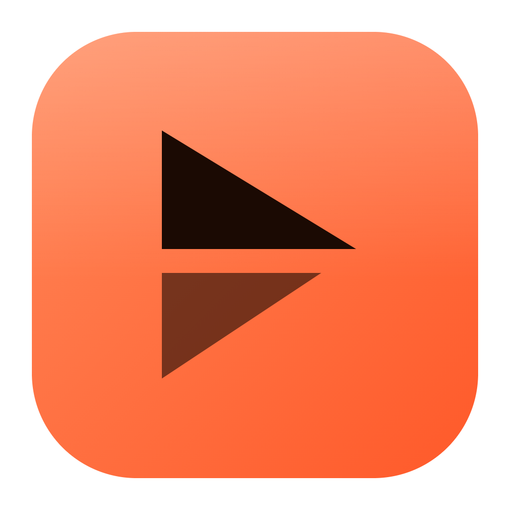

<p align="center">
  
</p>

<h1 align="center">Cutven</h1>

<p align="center">
  <b>YouTube içerik üreticileri için sade, hızlı ve tamamen çevrimdışı video editörü.</b><br/>
  CapCut'a ihtiyaç duymadan; hesap yok, abonelik yok, filigran yok.
</p>

---

## Neden Cutven?

Cutven, bir YouTube videosunu fikir aşamasından yayına kadar tek bir masaüstü uygulamasında hazırlaman için tasarlandı. Kurgu, seslendirme, küçük resim, intro/outro ve yayın takvimi aynı yerde. Her şey kendi bilgisayarında çalışır; dosyaların hiçbir yere yüklenmez.

Önizlemede ne görüyorsan dışa aktarılan videoda da birebir o çıkar: renkler, yazılar, geçişler ve ses seviyeleri aynı hesapla üretilir.

## Özellikler

### 🎬 Kurgu
- Çok izli zaman çizelgesi: taşıma, kırpma, bölme (`S`), kopyala/yapıştır, mıknatıslı hizalama
- Film şeridi ve ses dalga formu görünümü, yakınlaştırma
- Tuval üzerinde sürükleyerek konum, ölçek ve döndürme; merkez kılavuzları
- Hız (0,25× – 4×), opaklık, renk ayarları ve 12 hazır filtre
- Düz renk klipleri (arka plan, başlık kartı)
- Geri al / yinele, tıklanabilir **geçmiş paneli**, otomatik kayıt

### 🎯 Profesyonel kurgu
- **Araçlar:** seçim (`V`), dalgalı kırpma (`B`), kaydırma / slip (`Y`), hız esnetme (`T`)
- **Giriş / çıkış** (`I` / `O`), kaldır (`;`) ve çıkar (`'`): bir aralığı boşluk bırakarak ya da boşluğu kapatarak sil
- **Q / W:** klibin başını ya da sonunu imlece kadar kırp, arkası kendiliğinden kayar
- **Ctrl+K:** tüm izleri imleçten kes
- **Kaynak monitörü ve üç noktalı kurgu:** medyada giriş-çıkışı seç, `,` ile araya ekle (insert) ya da `.` ile üzerine yaz (overwrite)
- **J / K / L:** geri sar · durdur · ileri sar (tekrar bastıkça 2×, 4×, 8×)
- Renkli ve notlu işaretçiler (çift tık), `?` ile kısayol penceresi

### 🎨 Renk (Lumetri)
- **Temel düzeltme:** pozlama, vurgular, gölgeler, beyazlar, siyahlar, renk tonu, canlılık
- **Eğriler:** ana, kırmızı, yeşil, mavi; nokta ekle/sürükle
- **Renk tekerlekleri:** gölgeler, orta tonlar, vurgular
- **HSL ikincil:** sadece bir rengi (ten, gökyüzü, yeşillik) değiştir, maskeyi göster
- **Yaratıcı görünümler:** Teal & Orange, Sıcak film, Bleach bypass, Soğuk mavi, Mat, Noir, Cyberpunk, Altın saat
- **LUT yükleme (.cube)** ve güç ayarı
- **Skoplar:** dalga formu, vektörskop (ten çizgisiyle), histogram
- Tüm ayarlar tek bir 3D LUT'a dönüştürülür: önizleme ekran kartında (WebGL2), dışa aktarma FFmpeg `lut3d` ile — ikisi birebir aynı görünür

### 🧩 Anahtar kareler ve birleştirme
- **Görüntü anahtar kareleri (◆):** konum, ölçek, döndürme, opaklık; doğrusal, yumuşak, yavaş başla/bitir ve bekle geçişleri; ◀ ▶ ile kareler arası gezinme
- **Karışım modları:** çarp, ekran, bindirme, yumuşak/sert ışık, koyulaştır, açıklaştır, renk soldurma/yakma, ekle, fark, dışlama
- **Kırpma:** dört kenardan yüzde ile
- **Yeşil ekran (chroma key):** yeşil/mavi ya da önizlemeden renk seç, tolerans, yumuşatma, taşma giderme

### ✨ Geçişler
Solma, Çözülme, Siyaha, Beyaz flaş, dört yöne kaydırma, Yakınlaş, Döndür ve Bulanık. Klibin başına ya da sonuna sürüklemen yeterli.

### 🌀 Efektler & lens
28 efekt, üst üste kullanılabilir ve şiddeti ayarlanabilir:
- **Hareket:** Sallantı, Darbe, Nabız zoom (müziğin BPM'ine göre), Yaklaş / Uzaklaş (Ken Burns), Kaydırma, Salınım
- **Lens:** Balık gözü, Renk kayması (RGB split), Parlama, Işık sızıntısı, Vinyet, Bulanık, Keskin, Bulanık dolgu (dikey videoda boş kenarları doldurur)
- **Retro:** Glitch, VHS, Eski film, Film greni, Piksel, Poster
- **Stil:** Sinema bandı, Flaş, Negatif, Ayna, Dörtlü ekran, Yatay / dikey çevir

### 💡 Öneriler
Projeyi tarayıp "yayına hazırlık" puanı verir ve tek tıkla düzeltmeler önerir: ilk saniyelerde kanca yok, uzun sabit planlar, siyah boşluklar, uzun duraklamalar, kısık ses, müziğin konuşmayı bastırması, kenara taşan yazılar, abone ol hatırlatması, bitiş ekranı, bölümler, küçük resim…

### 📺 YouTube
Başlık, açıklama (bölümler, kanal şablonu ve hashtag'ler otomatik eklenir), etiket önerisi, kategori, dil, gizlilik ve planlı yayın. Kendi Google hesabını bağlayınca video ve küçük resim doğrudan yüklenir; istersen dışa aktarma biter bitmez otomatik.

### 🎥 Kayıt stüdyosu (OBS gibi)
Cutven aynı zamanda tam bir kayıt ve yayın programıdır. Ana ekrandan ya da editördeki **Stüdyo** düğmesinden açılır.
- **Sahneler ve kaynaklar:** ekran, pencere, kamera, görsel, video dosyası, yazı ve renk; sınırsız sahne, hazır şablonlar (Ekran + köşede kamera, Sadece kamera, Başlıyoruz…)
- **Tuvalde düzenleme:** sürükle, köşelerden boyutlandır, kenarlara ve ortaya yapışma, ok tuşlarıyla kaydırma, kırpma, Sığdır / Kapla / Ortala / Köşe
- **Kaynak filtreleri:** yeşil ekran, ayna, daire / yuvarlak köşe maske, kenarlık, opaklık, parlaklık / kontrast / doygunluk
- **Ses mikseri:** masaüstü sesi, birden çok mikrofon, kaynak sesleri; dB fader, VU metre, susturma, kulaklıktan dinleme, gürültü engelleme, gürültü kapısı, kompresör, kazanç, gecikme (dudak senkronu)
- **Kayıt:** MP4 ya da MKV, H.264 (ekran kartıyla) / VP9 / AV1, kalite ya da özel bit hızı, 720p – 4K, 30 / 60 fps, dikey (Shorts) tuval; duraklat / devam, geri sayım
- **Çökmeye dayanıklı:** kayıt diske akarak yazılır; elektrik kesilirse bir sonraki açılışta kurtarılır
- **Yayın + kayıt aynı anda** (YouTube Live ya da herhangi bir RTMP sunucusu)
- **Stüdyo modu:** sahneyi önizlemede hazırla, **Geçiş** ile yayına al; geçişler: kes, solma, kaydırma, yakınlaşma
- **Global kısayollar** (oyun ya da tarayıcı öndeyken de): kayıt Alt+F9, duraklat Alt+F10, mikrofonu sustur Alt+F8, ekran görüntüsü Alt+F7; hepsi değiştirilebilir
- Cutven penceresi ekran kaydında görünmez (sonsuz ayna yok), kayıtta pencereyi küçültme seçeneği
- Durum çubuğu: kayıt süresi, dosya boyutu, bit hızı, kare hızı ve gecikmeli kare, işlemci, boş disk
- **Kayıt arka planda sürer:** kurguya geçebilirsin; üst çubukta ● KAYIT rozeti görünür
- Bitince **tek tıkla kurgu:** açık projeye ekle ya da yeni projede aç

### 🔴 Canlı yayın
Ekran, kamera ya da ikisi birden (köşede yuvarlak kamera), başlık bandı, mikrofon ve bilgisayar sesi ile YouTube Live'a (veya herhangi bir RTMP adresine) yayın; aynı anda bilgisayara kayıt. 720p / 1080p / 1080p60.

### ✂️ Akıllı kurgu
Sahne değişimlerini algılayıp otomatik bölme, projeyi tek tıkla Shorts'a (9:16) çevirme.

### 🔤 Metin
YouTube'a uygun hazır stiller (başlık, altyazı, alt bant, "Abone ol"), 8 yazı tipi, kontur, gölge ve arka plan kutusu.

### 💬 Altyazılar
- **Konuşmadan otomatik altyazı:** videodaki konuşmayı yazıya döker ve cümleleri konuşulduğu ana yerleştirir (Whisper, bilgisayarında çalışır)
  - Dil: Türkçe, İngilizce, Almanca, Fransızca, İspanyolca, Arapça, Rusça ya da otomatik algıla
  - Model: Hızlı (~130 MB), Dengeli (~500 MB, önerilen), En doğru (~800 MB, Türkçede en iyi sonuç, daha yavaş)
  - Kaynak: konuşma (müzik ve efekt izleri hariç), duyulan tüm sesler ya da sadece seçili klip
  - Model ilk kullanımda bir kez indirilir (internet gerekir), sonra tamamen çevrimdışı çalışır; işlem iptal edilebilir
- Ayrı altyazı izi; satırları zamanla birlikte düzenle, imleçten böl
- **SRT / VTT** içe ve dışa aktarma
- **Senaryodan yerleştir:** senaryodaki cümleleri konuşmanın olduğu yerlere kendiliğinden yerleştirir
- Stil: Klasik, Shorts, Sarı, Sinema hazırları; yazı tipi, boyut, konum, kutu, kontur
- Videoya göm ya da dışa aktarırken yanına `.srt` koy

### 🎙️ Seslendirme
- Video oynarken kaydet; büyük kayıt düğmesi, 3-2-1 geri sayım
- Kayıt biter bitmez sonuç kartı: "çok hızlısın / yavaşsın / tam yerinde", bölüm bölüm hız şeridi ve öneriler
- Duraklat / devam et, baştan al, geri sarma
- Canlı ses seviyesi ve dalga formu, mikrofon seçimi, gürültü engelleme
- Kayıt bitince otomatik olarak doğru yere "Seslendirme" izine eklenir
- Senaryonu akan metin (prompter) olarak gösterir

### ⏱️ Tempo koçu
Videonun kurgu hızına ve müziğin temposuna (BPM) bakıp hangi hızda okuman gerektiğini söyler. Senaryonun süreye sığıp sığmadığını hesaplar, kaydını analiz eder ve kayıt sırasında canlı olarak "hızlısın / yavaşsın" der.

### 🔊 Ses
- **Anahtar kareler (◆):** sesi istediğin noktada kıs ya da aç (`K`)
- **Otomatik kısma (ducking):** konuştuğun yerlerde müziği kendiliğinden kısar
- Klip efektleri: Net ses, Güçlü, Bas, Radyo, Telefon, Megafon, Yankı, Oda, Salon, Gürültü azalt
- 53 hazır ses efekti (whoosh, boom, riser, gong, alkış, yağmur, 8-bit, komik sesler…); uygulama içinde üretilir, telifsizdir
- Sessizliklerden otomatik bölme ve sessiz kısımları silme (jump cut)
- Sesi videodan ayırma, sol/sağ kanal ayırma, basit vokal/müzik ayırma, WAV/MP3 kaydetme
- **Ekolayzer:** alçak kesme, bas, orta (ayarlanabilir frekans), tiz
- **Uğultu giderme** (50 / 60 Hz ve harmonikleri) ve **limiter**
- **Ses mikseri:** iz başına ses, pan, sessiz (M) ve solo (S)
- **Loudness ölçer:** anlık, kısa süreli ve toplam LUFS, tepe seviyesi; YouTube hedefine (−14 LUFS) göre yorum
- Dışa aktarmada YouTube standardına göre ses seviyesi (−14 LUFS, iki geçişli)

### 🖼️ Küçük resim (thumbnail)
1280×720 tasarlayıcı: önizlemedeki kareyi ya da bir görseli arka plan yap, büyük yazı ve görsel katmanları ekle, YouTube önerilerinde nasıl görüneceğine bak. PNG olarak kaydet ya da MP4'e kapak olarak göm.

### 🎞️ Intro & outro
Kendi intro/outro dosyanı bir kez seç, her projede tek tıkla ekle. Hazır şablonlar: başlık kartı, minimal, vurucu giriş, YouTube bitiş ekranı ve kısa kapanış.

### 📅 Yayın takvimi
Başlangıç ekranında "Bugün hangi video var?" kartı ve 7 günlük takvim. Her videoya yayın günü ve durum (Fikir · Çekim · Kurgu · Hazır · Yayında) ver.

### 📥 İçe aktarma
Dosya ya da klasör, panodan görsel (`Ctrl+V`), ekran kaydı, kamera kaydı.
Desteklenen biçimler: MP4, MOV, MKV, WEBM, AVI, GIF · MP3, WAV, M4A, FLAC, OGG · PNG, JPG, WEBP, SVG, TIFF.
Tarayıcının açamadığı videolar için önizleme kopyası otomatik hazırlanır.

### 📤 Dışa aktarma
- **Kodekler:** H.264, HEVC (H.265), ProRes 422 HQ, WebM (VP9), GIF, PNG kare dizisi; sadece ses (MP3)
- **Ekran kartıyla hızlandırma:** NVIDIA NVENC, Intel Quick Sync, AMD AMF (bilgisayarında çalışanlar otomatik bulunur)
- **Hazır ayarlar:** YouTube 1080p / 4K, Shorts · TikTok · Reels, Instagram, Arşiv, GIF
- 480p – 4K, 15 – 60 fps, üç kalite seviyesi
- Sadece **giriş → çıkış** aralığını dışa aktarma
- **Arka planda dışa aktarma:** pencereyi kapat, çalışmaya devam et; ilerleme üst çubukta
- Bölüm işaretçilerinden YouTube açıklamasına yapıştırmaya hazır bölüm listesi

### 🔁 Başka programlarla çalışma
Dosya menüsünden zaman çizelgesini **Premiere Pro / DaVinci Resolve için XML** (FCP7 XML), **EDL (CMX3600)** ya da **OpenTimelineIO (.otio)** olarak kaydet. Kesimler, hız, ses/opaklık seviyeleri ve işaretçiler aktarılır.

### 🛟 Güvenlik ağı
- Her 5 dakikada otomatik **sürüm yedeği** (son 40 sürüm); Dosya › Sürüm geçmişi'nden tek tıkla geri dön
- **Çökme kurtarma:** Cutven beklenmedik kapanırsa açılışta son projeyi geri açmayı önerir

## Kurulum

Kurulum dosyasını aşağıdaki [Geliştirme](#geliştirme) adımlarıyla kendin üretebilirsin (`npm run dist` → `release/Cutven-Setup-1.0.0.exe`). Dosyayı çalıştırıp adımları izle. Uygulama imzasız olduğu için Windows ilk açılışta uyarı gösterebilir: **Ek bilgi → Yine de çalıştır**.

Projeler kendiliğinden `Belgeler/Cutven Projeleri` klasörüne kaydedilir; ses ve ekran kayıtları proje klasöründeki `Cutven Kayıtlar` içinde durur.

## Klavye kısayolları

| Kısayol | İşlev |
| --- | --- |
| `Boşluk` | Oynat / duraklat (kayıtta: duraklat / devam) |
| `S` | Böl |
| `Del` · `Shift+Del` | Sil · Silip boşluğu kapat |
| `K` | Ses anahtar karesi ekle / kaldır |
| `R` | Seslendirme kaydını başlat / durdur |
| `M` | Bölüm işaretçisi ekle |
| `N` | Mıknatıs aç / kapat |
| `←` `→` | Bir kare ileri / geri (`Shift` ile 1 sn) |
| `↑` `↓` | Önceki / sonraki kesim |
| `Ctrl+C` · `Ctrl+V` · `Ctrl+D` | Kopyala · Yapıştır · Çoğalt |
| `Ctrl+Z` · `Ctrl+Y` | Geri al · Yinele |
| `Ctrl+S` · `Ctrl+E` · `Ctrl+I` | Kaydet · Dışa aktar · İçe aktar |
| `J` · `K` · `L` | Geri sar · Durdur · İleri sar |
| `I` · `O` · `X` | Giriş · Çıkış · Klibin etrafını işaretle |
| `;` · `'` | Kaldır (lift) · Çıkar (extract) |
| `Q` · `W` | Başı / sonu imlece kadar kırp (dalgalı) |
| `Ctrl+K` | Tüm izleri imleçten kes |
| `,` · `.` | Kaynaktan ekle · Üzerine yaz |
| `V` · `B` · `Y` · `T` | Seçim · Dalgalı kırpma · Slip · Hız esnetme |
| `?` | Tüm kısayollar |

## Geliştirme

Gereksinim: Node.js 20+ (Windows).

```bash
npm install
```

```bash
npm run build:web && npm start
```

Windows kurulum dosyası üretmek için:

```bash
npm run dist
```

Çıktı `release/` klasörüne yazılır.

GitHub'a her gönderimde **Windows kurulum dosyası** otomatik derlenir (`.github/workflows/windows-build.yml`): Actions sekmesinde ilgili çalışmayı aç, en alttaki **Artifacts** bölümünden `Cutven-Setup-…` dosyasını indir. Elle başlatmak için: Actions → *Windows kurulum dosyası* → *Run workflow*.

### Teknoloji

- **Electron** — masaüstü kabuğu, dosya erişimi, ekran/kamera kaydı
- **React + TypeScript + Vite** — arayüz
- **FFmpeg** (ffmpeg-static) — dışa aktarma, önizleme kopyaları, ses analizi
- **Whisper** (transformers.js + ONNX Runtime) — otomatik altyazı; ayrı bir arka plan sürecinde, işlemcide çalışır
- **Canvas 2D + Web Audio** — gerçek zamanlı önizleme ve ses efektleri

### Klasör yapısı

```
electron/        Ana süreç: pencere, IPC, FFmpeg işleri, dosya akışı
  asr.cjs           Otomatik altyazı: ses çıkarma, model önbelleği, arka plan süreci
  studio.cjs        Kayıt stüdyosu: dosyaya yazma, MP4/MKV'ye çevirme, kurtarma, global kısayollar
  asr-core.cjs      Konuşma tespiti (VAD), Whisper ile yazıya dökme
src/
  components/    Arayüz bileşenleri (zaman çizelgesi, önizleme, paneller…)
  lib/
    engine.ts       Oynatma motoru (video, ses, efekt zinciri)
    render.ts       Kare çizimi (önizleme)
    exporter.ts     FFmpeg filtre grafiği (dışa aktarma)
    transitions.ts  Geçişler (önizleme + FFmpeg ortak matematik)
    afx.ts          Ses efektleri
    keyframes.ts    Ses anahtar kareleri ve otomatik kısma
    vkeys.ts        Görüntü anahtar kareleri (önizleme + FFmpeg ifadeleri)
    lumetri.ts      Renk düzeltme → 3D LUT (lutgl.ts: WebGL2 önizleme)
    keygl.ts        Yeşil ekran (önizleme, FFmpeg chromakey ile aynı formül)
    captions.ts     Altyazılar (SRT/VTT, otomatik zamanlama, gömme)
    autocaptions.ts Konuşmadan otomatik altyazı (kaynak seçimi, ilerleme)
    studio/         Kayıt stüdyosu: sahneler ve ayarlar (state.ts), kompozitör, mikser, kayıt, yayın (engine.ts)
    proedit.ts      Giriş/çıkış, lift/extract, üç noktalı kurgu
    mix.ts          İz mikseri ve loudness ölçer
    interchange.ts  FCP7 XML, EDL, OpenTimelineIO
    exportRun.ts    Arka planda dışa aktarma
    vfx.ts          Görsel / lens efektleri (önizleme + FFmpeg)
    suggest.ts      Öneriler
    youtube.ts      YouTube bilgileri ve yükleme
    live.ts         Canlı yayın sahnesi
    recorder.ts     Seslendirme kaydı
    tempo.ts        Tempo koçu (BPM, hece hızı)
    audiotools.ts   Sessizlik, kanal ayırma
    sfx.ts          Ses efekti kütüphanesi
    thumb.ts        Küçük resim
    introoutro.ts   Intro / outro şablonları
build/           Uygulama simgesi
```

---

<p align="center">Kendi videolarını kendi aracınla kurgula. 🎬</p>
